<p align="center">
  
</p>

# Cherry Keys for Mac

**Make your CHERRY keyboard feel at home on a Mac.**

I built this because the keyboard I wanted to use shipped with Windows-only [CHERRY KEYS software (official download)](https://www.cherry.de/en-gb/products/software-services/cherry-keys). I investigated its behavior, designed a native Mac alternative, and tested it against the real keyboard across every connection mode. The work went beyond mapping keys: isolating the right device, separating privileged capture from user actions, fixing Bluetooth LED feedback, and recovering after sleep and lock. Each fix followed a user-visible problem and a physical check. This project turns that work into an open-source foundation other Mac users can extend for their own CHERRY hardware.

**4 connection modes verified · 183 key/transport checks + 10 recovery checks · 0 third-party runtime dependencies**

Swift and SwiftUI. MIT licensed. Independent community software, not affiliated with or endorsed by CHERRY.

Current preview: **v0.4.6 (build 18)** · [Changelog](CHANGELOG.md) · [GitHub release](https://github.com/benchiatc/cherry-keys-for-mac/releases/tag/v0.4.6)

**v0.4.6 restores modifier + mouse shortcuts**, including TradingView's Shift-click ruler. The fix was physically confirmed on the F1 receiver in local v0.4.5 build 17; build 18 carries the same fix with updated release metadata. Download v0.4.6 using the illustrated installation guide below. The [previous v0.4.5 build 16](https://github.com/benchiatc/cherry-keys-for-mac/releases/tag/v0.4.5) does not contain this fix.

### What you can do

- **Make the layout feel native:** remap keys and swap Windows/Alt to Command/Option.
- **Customize both layers:** assign preset commands and standard Fn + F-keys independently.
- **Launch Mac actions:** Spotlight, screenshots, Emoji & Symbols and media controls.
- **Automate everyday tasks:** create shortcuts, text snippets and recorded keyboard macros.
- **Use modifiers with your mouse:** keep Shift-click, Command-click and other modifier combinations while remapping is active.
- **Keep your setup across connections:** use the same selected profile over the receiver, Bluetooth or USB cable.
- **See your lock state:** synchronize Caps Lock and Num Lock behavior with their LEDs.
- **Keep it running quietly:** use the menu bar and resume automatically after sleep or unlock.

## Contents

- [Changelog](CHANGELOG.md)
- [Install and get started](#install-and-get-started)
- [Everyday use](#everyday-use)
- [Compatibility](#compatibility)
- [How it works](#how-it-works)
- [Hardware specifications](#hardware-specifications)
- [Mapping behavior and limits](#mapping-behavior-and-limits)
- [Build, test and distribute](#build-test-and-distribute)
- [Security](#security)
- [Contributing](#contributing)
- [License and provenance](#license-and-provenance)

## Install and get started

You need a **Mac running macOS 13 or later** and a CHERRY keyboard. The **KW X ULP** is the model tested so far. Your other keyboards can stay connected.

| Choose | Best for | What you need |
| --- | --- | --- |
| [Option A: Install the DMG](#option-a-install-the-dmg) | Using the app with the least setup | The packaged app; no Terminal or compiler |
| [Option B: Build from source](#option-b-build-from-source) | Reviewing the implementation, customizing behavior, adding keyboard support or contributing | The source code and Apple's Command Line Tools |

Both options install the same app and use the same macOS permission setup.

### Option A: Install the DMG

**Start here if you just want to use the app.** No Terminal, coding tools or GitHub account is needed. Copying the app is only the first part: you must also complete the two permissions and helper approval in steps 5–9 before enabling remapping.

These pictures were captured on macOS 27.0.1. Older versions may use different names; the steps below give the alternatives. Click a picture to enlarge it. The first-run app pictures are labelled previews with a sample profile. The macOS permission pictures show what the switches look like when enabled; unrelated entries are hidden.

**Before you start:** connect your CHERRY keyboard using its receiver, Bluetooth or USB cable. If you are upgrading, quit the old app first. If the release changes its helper or signing identity, follow the [upgrade instructions](docs/DEVELOPMENT.md#upgrades-and-removal) before replacing it. If Karabiner-Elements, BetterTouchTool or another keyboard app has CHERRY-specific mappings, turn those mappings off to avoid conflicts.

<details>
<summary><strong>Step-by-step installation guide — steps 1–11, screenshots and troubleshooting</strong></summary>

#### 1. Download the installer, not the source code

Open the project's **[GitHub Releases page](https://github.com/benchiatc/cherry-keys-for-mac/releases)**. Open the release you want, scroll to **Assets**, and click the file whose name ends in **`.dmg`**. If Assets is collapsed, click it to expand the list.

For v0.4.6, download **[CherryKeysMac-0.4.6-macOS-universal.dmg](https://github.com/benchiatc/cherry-keys-for-mac/releases/download/v0.4.6/CherryKeysMac-0.4.6-macOS-universal.dmg)**. The screenshot shows v0.4.5 as an example; the filename's version will change with releases. “Universal” means the same installer works on Apple silicon and Intel Macs.

Choose the **DMG**, rather than `CherryKeysMac-source.zip`, **Source code (zip)** or **Source code (tar.gz)**. Those are for developers. If your browser asks whether to allow downloads from GitHub, choose **Allow**. When the download finishes, look in **Finder → Downloads**, or use your browser's Downloads button.

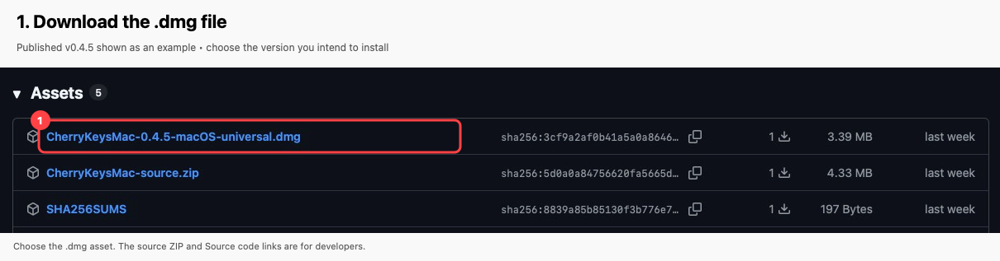

#### 2. Open the DMG and copy the app

In Downloads, double-click the `.dmg` file. A window called **Cherry Keys for Mac** opens. **Drag the Cherry Keys for Mac app icon onto the Applications folder shortcut**, then wait for copying to finish. The app and folder may appear in a different order on your Mac. **Installation Guide.html** in the same window contains these illustrated instructions offline; open it before ejecting the DMG, or copy the HTML file to your Mac to keep it.

If Finder asks whether to replace an existing copy, first check that the old app is quit and that you have followed any upgrade notes. Choose **Replace** when ready. If macOS asks you to authorize copying into Applications, use your Mac's administrator account or ask its administrator.

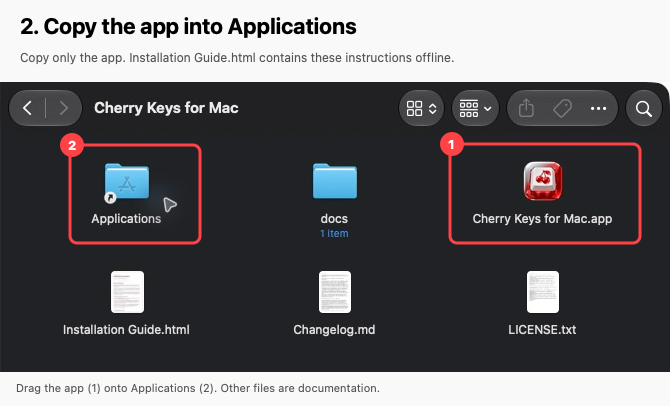

#### 3. Eject the installer and open the installed app

Close the installer window. In Finder's sidebar under **Locations**, click the eject symbol beside **Cherry Keys for Mac**. You can also select that mounted disk and press **Command-E**. The downloaded `.dmg` file may stay in Downloads; it is only the installer.

Open **Finder → Applications**, then double-click **Cherry Keys for Mac**. Keep the app's name unchanged. **Always run the Applications copy**, rather than the copy inside the mounted DMG. If macOS asks whether you want to open an app downloaded from the internet, check its name and choose **Open** if you intend to run this build.

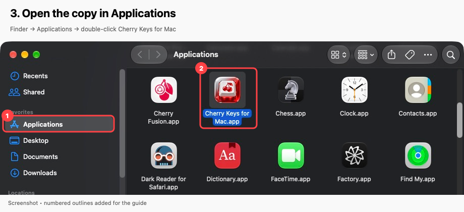

#### 4. If macOS blocks the first launch

**Skip this step if the app opens.** This community preview is locally signed and has not been notarized by Apple, so another Mac may block it even if it opens on the developer's Mac.

If the message says Apple cannot verify the developer or check the app for malicious software:

1. Dismiss the message with **Done**, **OK** or **Cancel**; the wording varies.
2. Open the **Apple menu → System Settings → Privacy & Security**.
3. Scroll down to **Security**. Look for a message specifically naming **Cherry Keys for Mac** and an **Open Anyway** button. This appears only after a blocked opening attempt.
4. If you obtained this app from the project and trust it, click **Open Anyway**. Follow the Mac's authentication prompt, then confirm **Open** if asked. This creates an exception for this app.

Do not change **Allow applications from** or disable Gatekeeper, SIP, signature checks or privacy controls. If the message instead says the app **will damage your computer**, **contains malware** or **is damaged**, stop and check the download; this guide does not ask you to override those warnings. On a work or school Mac, an administrator may control these options. See [Apple's explanation of opening downloaded apps](https://support.apple.com/en-us/102445).

The screenshot locates the Security section. This Mac has no pending blocked-app message, so **Open Anyway is not visible in this picture**.

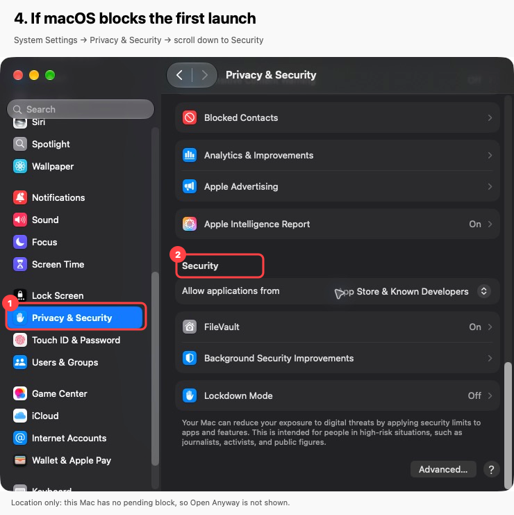

Continue with every setup step below. Opening the app does not grant its keyboard permissions automatically.

### Finish setup (both options)

#### 5. Locate the setup buttons in Cherry Keys

On a new Mac, the app starts **Remapping paused**. An orange panel shows **Accessibility: this copy needs approval** and **Input Monitoring: approval needed**. The buttons on its right open the corresponding Mac settings. **Set up helper…** is in the left sidebar.

Also look under **HARDWARE**. Your connected CHERRY keyboard should appear there. If it says **No CHERRY device detected**, check the cable/receiver or Bluetooth connection, then click **Refresh devices**.

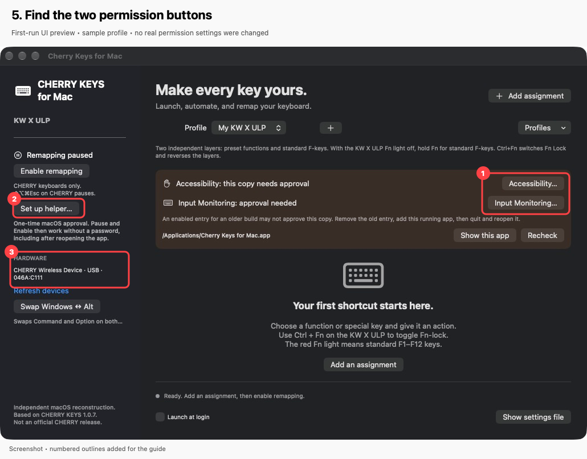

#### 6. Allow Accessibility

This lets Cherry Keys send the remapped keyboard input and modifier + mouse combinations you request.

1. In Cherry Keys, click **Accessibility…**. If a macOS message offers **Open System Settings**, choose it.
2. Find **Cherry Keys for Mac** in the list and turn **its switch ON**. On this Mac, ON is blue with the knob on the right.
3. If asked, use **Touch ID** or enter your **Mac login/administrator password** to approve the change. This is a macOS prompt; there is no separate Cherry Keys password. On a managed Mac, ask its administrator if you cannot authorize it.

To get there manually, open **System Settings → Privacy & Security → Accessibility**. On the Mac used for these screenshots, the same destination is labelled **Device Control and Data Access**. This is different from the top-level **Accessibility** page for display, hearing and motor settings. Using the app's **Accessibility…** button avoids that mix-up.

**If Cherry Keys is missing from the list:** click **+** at the bottom, authenticate if asked, choose **Applications → Cherry Keys for Mac**, then click **Open**. Turn on the new entry. Select the installed app, rather than a helper executable or a copy in Downloads/the DMG. In the file chooser, **Command-Shift-G**, followed by `/Applications/Cherry Keys for Mac.app` and Return, can help locate it.

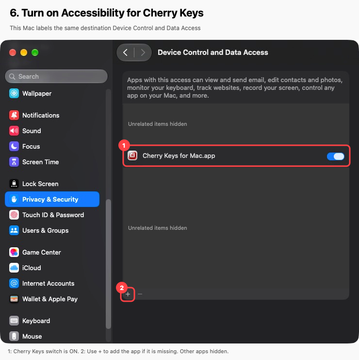

#### 7. Allow Input Monitoring as well

This is a **second, separate permission** that lets Cherry Keys read the CHERRY keyboard. Turning on Accessibility alone is not enough.

1. Return to Cherry Keys and click **Input Monitoring…**. If a macOS message offers **Open System Settings**, choose it.
2. In **System Settings → Privacy & Security → Input Monitoring**, turn **Cherry Keys for Mac ON**.
3. Authenticate with Touch ID or your Mac password if asked. If the app is missing, use **+ → Applications → Cherry Keys for Mac → Open**, then enable its switch, just as in step 6.
4. If macOS offers **Quit & Reopen**, choose it. Otherwise, complete the restart in step 8 yourself.

The app should be enabled in **both** permission lists. [Apple's Input Monitoring guide](https://support.apple.com/en-ie/guide/mac-help/mchl4cedafb6/mac) describes this separate permission.

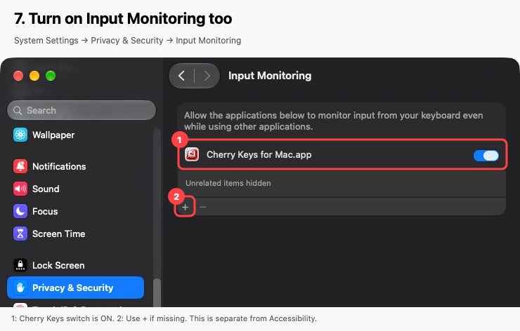

#### 8. Quit fully and reopen

Return to Cherry Keys. Choose **Cherry Keys for Mac → Quit Cherry Keys for Mac** from the menu bar at the top of the screen, or press **Command-Q** while its window is active. **The red close button only closes the window; it does not quit the app.**

Then reopen **Finder → Applications → Cherry Keys for Mac**. If the permission panel remains visible, click **Recheck**. Once both permissions are recognized, the panel disappears. Remapping still starts paused; that is expected.

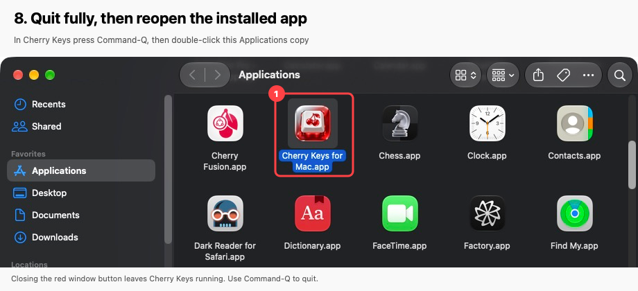

#### 9. Set up and approve the helper

The helper gives the app access to the supported CHERRY keyboard interfaces. It is separate from both permissions above.

1. In Cherry Keys' left sidebar, click **Set up helper…**. If it says **Approve helper…**, click that instead. If you already see **Helper approved**, skip to step 10.
2. Follow any macOS authentication prompt. If settings open, go to **System Settings → General → Login Items & Extensions**. Some macOS versions call the page **Login Items**.
3. Under **Allow in the Background**, **App Background Activity** or **Background App Activity**, enable the entry for **Cherry Keys for Mac**. If an entry uses a developer/helper name, inspect its information/details to confirm it belongs to Cherry Keys; do not enable unrelated entries.
4. Return to Cherry Keys and wait for **Helper approved** in the left sidebar. If needed, click **Refresh devices** to refresh the status. If approval is still pending, return to the background activity list and check its switch.

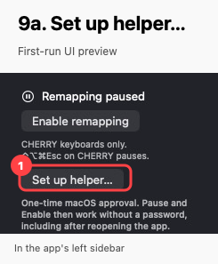

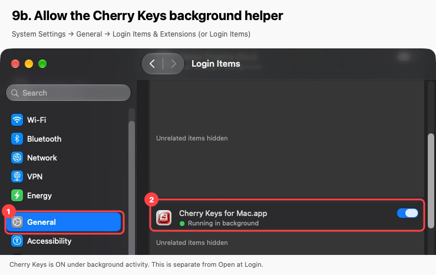

**Do not confuse background helper approval with Open at Login.** **Launch at login** in Cherry Keys is optional; it starts the app when you sign in. It does not replace helper approval or either keyboard permission. Helper setup is normally needed once, rather than every time you Pause or Enable. [Apple's Login Items guide](https://support.apple.com/en-hk/guide/mac-help/mtusr003/mac) explains the two lists.

#### 10. Choose your layout, then enable remapping

For a familiar Mac modifier layout, click **Swap Windows ↔ Alt** once. Physical Alt becomes Command, and the Windows key becomes Option. This creates or replaces the four modifier assignments for both sides of the keyboard. Skip the swap if you want to keep the existing layout. Use **Add assignment** if you want to customize another key; adding an assignment is optional.

Click **Enable remapping** in the left sidebar. A new profile's assignment list may be empty; the screenshot below shows an existing profile as an example.

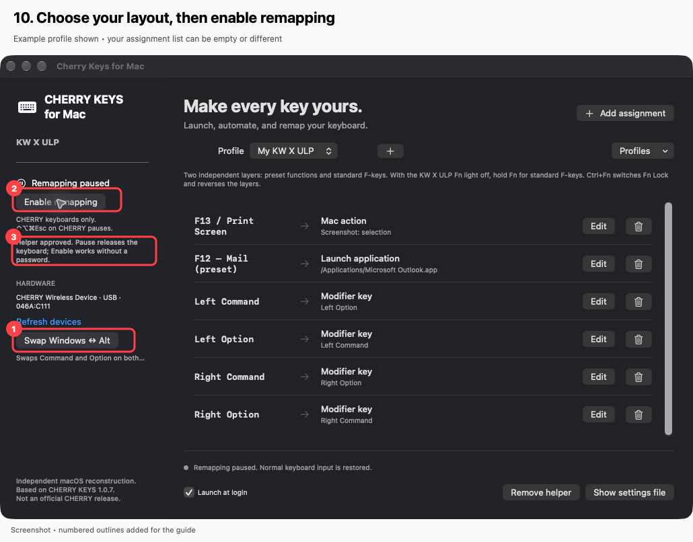

#### 11. Confirm that setup is complete

Check for all three signs:

1. **Remapping on** appears in green in the left sidebar, and the button now says **Pause remapping**.
2. **Helper approved** appears below it.
3. The bottom status says **CHERRY capture active.**

Open **TextEdit**, create a new document and type a short sentence with your CHERRY keyboard. Hold Shift to type a capital letter. Try any assignment you created. If you use TradingView and have the v0.4.6 fix, hold Shift and click the chart to check the ruler.

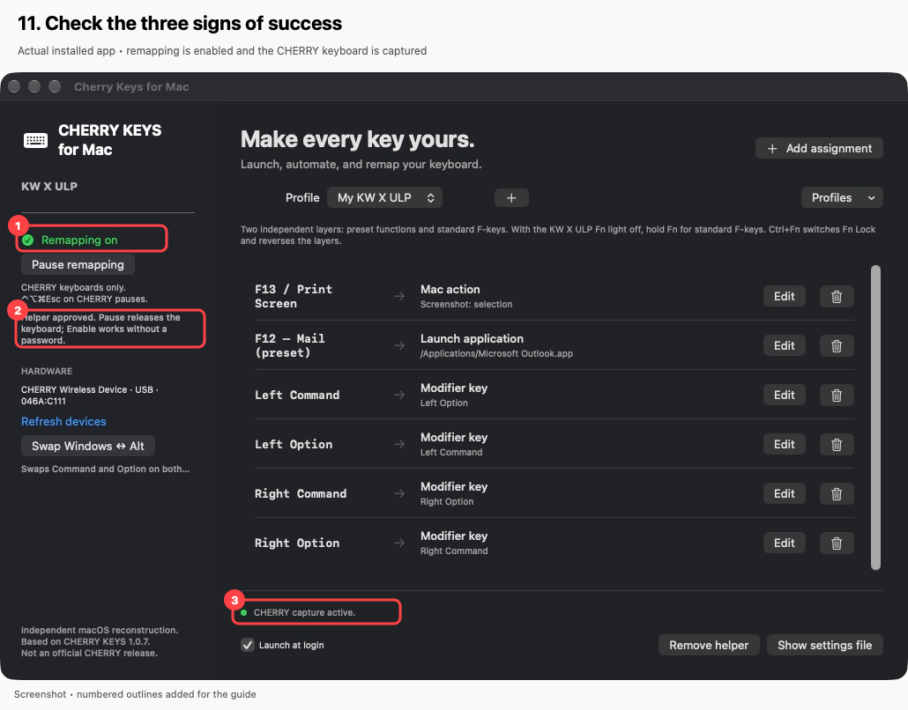

You can now close the Cherry Keys window; it continues in the menu bar. Each fresh app launch starts paused, so choose **Enable remapping** after reopening it. After you have enabled it, temporary sleep/lock interruptions resume automatically. Enable **Launch at login** only if you want the app to open when you sign in.

**Preset or Fn key?** On the KW X ULP with its Fn light off, choose **F12 — Mail (preset)** to change the Mail button, or **Fn + F12 — standard F12** for the other layer. Ctrl+Fn reverses which layer needs Fn. Browser Home and Calculator have named preset triggers too.

#### If a step does not work

| What you see | What to do |
| --- | --- |
| The app will not open | Follow step 4 for a developer/notarization block. Check the actual message before proceeding. |
| Cherry Keys is missing from a permission list | Use that list's **+** button to add the installed Applications copy, then turn its switch on. |
| Both switches are on, but the app still asks for approval | Quit and reopen, then click **Recheck**. An old build's entry may not approve the new copy. If needed, quit the app, remove only the stale Cherry Keys entry with **−**, add the current Applications copy with **+**, enable it and reopen. |
| You cannot change a switch or approve the helper | Authenticate with a Mac administrator account, or ask the administrator of a managed Mac. |
| Helper approval remains pending | Recheck **General → Login Items & Extensions → background activity**, then return to the app and click **Refresh devices**. Read any inline setup error. |
| No CHERRY device appears | Check the selected keyboard connection, reconnect its receiver/cable or Bluetooth, then click **Refresh devices**. |
| The app says it must run from Applications | Quit it, eject the DMG, then open the copy in **Finder → Applications**. |
| Remapping is paused after reopening | Normal startup behavior: click **Enable remapping**. |
| Keys or shortcuts behave strangely | Click **Pause remapping**. Check for another remapper controlling the CHERRY keyboard and review your assignments. |

If you still need help, note your macOS version, app version, keyboard connection, the step where setup stopped and the exact on-screen error. Keep passwords, profile exports and private device details out of public reports.

</details>

### Option B: Build from source

**Choose this if you want to explore the code, make changes, support another keyboard or contribute.** This route creates the app directly from the source on your Mac, ready for your own development workflow.

1. Get the source with **[Download ZIP](https://github.com/benchiatc/cherry-keys-for-mac/archive/refs/heads/main.zip)**, then double-click the ZIP to extract it. Contributors can clone the GitHub repository instead.
2. Open **Terminal** from Applications → Utilities.
3. Paste this command and press Return. If macOS offers to install Command Line Tools, finish that installation before continuing. If they are already installed, continue to the next step.

   ```sh
   xcode-select --install
   ```

4. In Terminal, type `cd` followed by a space. Drag the extracted project folder from Finder into Terminal, then press Return. This selects the project folder.
5. Paste these commands and press Return:

   ```sh
   python3 scripts/prepare-local-signing.py
   ./scripts/build.sh
   open .build/package.noindex
   ```

6. When Finder opens, drag **Cherry Keys for Mac.app** into **Applications**. Keep its name unchanged, then open it from Applications.
7. Expand the **Step-by-step installation guide** above and continue at **step 5** in [Finish setup](#finish-setup-both-options); source builds need the same permissions and helper approval. For tests and development tools, see [Build, test and distribute](#build-test-and-distribute).

The build can take a few minutes. If a command reports an error, stop there and include that error in a support request—do not run the commands with `sudo`. Before replacing an existing installation, quit it and follow the [upgrade instructions](docs/DEVELOPMENT.md#upgrades-and-removal).

## Everyday use

| What you want | What to do |
| --- | --- |
| Keep remapping in the background | Close the window with Command+W; the menu-bar icon stays active |
| Use TradingView’s ruler | Hold Shift and click on the chart with remapping enabled; requires the v0.4.6 fix |
| Change your assignments | Open Cherry Keys from its menu-bar icon |
| Temporarily use the normal keyboard behavior | Choose **Pause remapping** |
| Stop the app | Choose **Quit** |
| Start the app when you log in | Enable **Launch at login** |
| Keep different sets of assignments | Create profiles and select the one you want |
| Change preset F12 without changing Fn + F12 | Assign **F12 — Mail (preset)**; leave the standard trigger unchanged |
| Recover if a mapping gets in your way | Use the menu-bar Pause button, or press **Control–Option–Command–Escape** on CHERRY |

Each app launch starts with remapping paused. Once enabled, it resumes automatically after sleep/wake or lock/unlock; you do not need to enable it again. A manual Pause stays paused. Remapping is suspended during protected password entry, so lock-screen input uses native keyboard behavior.

Profiles can be exported and imported as JSON. They may contain private text or file paths, so review them before sharing. Settings and a rolling backup stay on your Mac.

## Compatibility

**Tested model: CHERRY KW X ULP.**

| Connection | Guided checks passed |
| --- | --- |
| F1 wireless receiver, including through a USB hub | Typing, modifier mappings, Caps/Num behavior and LEDs |
| F2 Bluetooth 1 | Same, with immediate LED feedback |
| F3 Bluetooth 2 | Same, including capture after changing Bluetooth slots |
| USB cable | Same, with immediate LED feedback |

All four modes were rechecked on **v0.4.3 build 12** after helper hardening. Automatic recovery after sleep and lock was physically confirmed on **v0.4.4 build 13**. The latest preset/Fn separation and Calculator were physically confirmed on **v0.4.5 build 16 over F1**; the other three connections have automated coverage for this change but await that specific physical recheck. The modifier + mouse fix was physically confirmed in TradingView on the **F1 receiver using local v0.4.5 build 17**, then prepared as **v0.4.6 build 18** with the same implementation. Its Bluetooth/wired operation, other modifier + mouse combinations and recovery under held modifiers still need physical checks. These results come from one keyboard on one Apple silicon Mac; they are not a guarantee for every model, layout or macOS version.

Other CHERRY USB keyboards may work but are untested. Other CHERRY Bluetooth models need their device identities verified and added. Non-CHERRY keyboards stay on their normal macOS path; the connected Logitech receiver was verified as excluded by the device filter.

No Karabiner, Wine, Windows VM or driver extension is required. If another remapper already controls the CHERRY keyboard, release that device in the other app before enabling this one.

The sections below cover the implementation, extension points and validation for contributors.

## How it works

The app takes exclusive control of supported CHERRY keyboard interfaces, routes their input through the selected profile, and sends replacement key events to macOS. Input retains its device identity before macOS merges keyboards, so other brands' keyboards are left alone.

While remapping is active, a user-session event tap adds held CHERRY modifier outputs to mouse clicks, movement, drags and scrolling. Native mouse-event flags are preserved, so modifiers held on another keyboard continue to work. Pause, disconnect and recovery cleanup clear the CHERRY state; stopping remapping removes the event tap.

The design separates three responsibilities:

| Process | Runs as | Responsibility |
| --- | --- | --- |
| App | Logged-in user | Interface, profiles, mapping and action execution |
| Approved broker | Root | Authenticate the app and launch the fixed capture executable |
| Bounded capture child | Root | Read verified CHERRY interfaces and update standard lock LEDs |

The privileged processes do not execute profiles or arbitrary commands. The broker validates a protected snapshot of the capture executable before launching it, avoiding replacement of a user-writable binary between verification and execution. IPC uses certificate-authenticated XPC and a private Unix-domain socket.

Pause, Quit, disconnect and failure release synthesized keys. Capture heartbeats expire after two seconds, and a capture session has a four-hour ceiling. Temporary sleep/session/secure-input interruptions preserve enabled intent; permanent errors and explicit Stop cancel recovery. Workspace notifications and a 500 ms recovery check restart capture when the console session is active and Secure Keyboard Entry has ended. Cancelled macros are not replayed on wake.

See [architecture and privilege boundaries](docs/ARCHITECTURE.md) for the full process and lifecycle design.

## Hardware specifications

| KW X ULP mode | Reported identity | Input layout |
| --- | --- | --- |
| F1 receiver | USB `046A:C111`, CHERRY Wireless Device | Separate keyboard and consumer-control interfaces |
| F2 / F3 Bluetooth | BLE `0687:C113`, CHERRY KW X ULP | Combined keyboard, consumer and auxiliary vendor collections |
| USB cable | USB `046A:C112`, CHERRY Corded Keyboard | Separate keyboard and consumer-control interfaces |

USB matching uses CHERRY vendor `046A`, then validates keyboard and associated consumer collections. BLE matching requires vendor `0687`, product `C113`, Bluetooth vendor source `1`, the exact model name, and Bluetooth Low Energy transport. The two Bluetooth slots expose distinct connection identities but the same model/report layout. Vendor IDs are self-reported compatibility selectors, not cryptographic authentication.

The verified BLE model's opaque vendor input report `0x11` is ignored. Unexpected unsupported input collections cause capture to stop rather than swallowing unhandled input. CHERRY mice and separate vendor-control interfaces are excluded. Caps/Num indicator writes target only standard HID LED page `8`, usages `1` and `2`; no firmware or vendor-lighting commands are sent.

There is no reliable shared physical-unit identifier established across all four modes. The active profile applies to every captured CHERRY keyboard, not a uniquely enrolled physical unit. Profile selection is manual.

To extend support, follow [adding hardware](docs/HARDWARE.md). Keep raw device dumps, serials, addresses and connection UUIDs private.

## Mapping behavior and limits

### Actions

Supported actions include modifier remapping, shortcuts, Unicode text insertion, recorded keyboard macros, application/file/folder/website launch, media/volume/brightness controls, browser back/forward, default mail app launch, disable, screen lock and sleep. There are **18 Mac action presets**, including Spotlight, Emoji & Symbols, screenshots, window/tab controls, Find and Select All.

**Swap Windows ↔ Alt** creates four editable assignments, covering both sides of the keyboard. It replaces existing assignments on those four modifier keys. Modifier mappings preserve held-key behavior for keyboard and mouse input. While a CHERRY modifier is held, mouse clicks, movement, drags and scrolling include its mapped output; native event flags from other keyboards are preserved. Ordinary assignments apply without Command/Control/Option/Shift held.

Text, macro, launch and system actions run on trigger release. Keyboard shortcuts preserve down/up and repeat. Key labels follow physical US positions; the active layout and application shortcut settings affect interpretation. Hardware Fn may not generate an OS-visible event. Caps Lock and hardware Fn are not assignable triggers.

### Alternate F8 / F11 / F12 functions

The KW X ULP can send Consumer-page controls instead of regular function keys. The app and DMG recognize these from v0.4.5 onward without pausing capture:

| Trigger in the editor | HID page / usage | Default behavior |
| --- | --- | --- |
| F8 — Browser Home (preset) | `12 / 0x223` | Send Command–Shift–H to the foreground app; supported browsers use it for their homepage |
| F11 — Calculator (preset) | `12 / 0x192` | Open macOS Calculator |
| F12 — Mail (preset) | `12 / 0x18A` | Open your default mail app without composing a message |

**Preset functions and standard F-keys are independently assignable.** With the KW X ULP Fn light off, F8/F11/F12 send the presets above; holding Fn sends standard F8/F11/F12. Ctrl+Fn changes Fn Lock and reverses the layers. The app labels the two choices, for example **F12 — Mail (preset)** and **Fn + F12 — standard F12**, and explains this in the main window and assignment editor. Labels describe the Fn-light-off arrangement; the app routes the event actually sent by the keyboard and does not read the Fn light.

The selected profile is shared across the F1 receiver, F2/F3 Bluetooth and wired USB. Connection identity is used to track held keys and disconnects; it does not select a different mapping or merge the two layers. Automated tests cover all four normalized input paths and all 12 directed channel transitions. These tests do not replace physical checks on each connection.

Choose the preset trigger to replace its built-in action, or the standard F-key trigger to assign the Fn layer. There is no inheritance between them. For example, assign **F12 — Mail (preset)** to a mail application while leaving **Fn + F12 — standard F12** unassigned or mapping it to something else. Other models' Fn layouts may differ. Existing saved triggers retain their meaning; builds do not automatically move users' assignments between layers.

Defaults and custom launch actions run once on release. Unknown controls still release capture and restore native input instead of silently swallowing a key. Use v0.4.5 or later for these controls. On build 16 over the F1 receiver, the user confirmed the independent layers: the customized F12 preset opens the selected application, Fn + F12 does not invoke that assignment, and Calculator works. Browser Home produced no visible effect in that session, so browser-specific Home behavior remains unverified.

Usage names follow the [USB-IF HID Usage Tables](https://www.usb.org/sites/default/files/hut1_21_0.pdf). Browser Home uses the [standard Safari homepage shortcut](https://support.apple.com/en-gb/guide/safari/cpsh003/mac); the foreground application's shortcuts and settings determine its effect.

### Lock keys

Unassigned Num Lock toggles numeric/navigation keypad mode and starts enabled per app session. Navigation maps 1/2/3/4/6/7/8/9 to End/Down/Page Down/Left/Right/Home/Up/Page Up; 0 emits Help/Insert and decimal emits Forward Delete. Keypad 5 is silent. Explicit assignments take precedence.

Caps/Num LEDs follow the relayed state where standard outputs are available. LED values are sent on state changes and committed together to avoid polling delay and redundant Bluetooth transactions. Indicator color is a hardware property.

### Profiles and limits

Settings live under `~/Library/Application Support/CherryKeysMac/`, with atomic saves and one rolling backup. JSON reads/saves are limited to 4 MiB; configurations allow up to 100 profiles, 1,000 assignments per profile and 64 KiB of text per assignment. Macros allow up to 4,000 events, 30 seconds per delay and five minutes total duration.

Macro recording is limited to keyboard input inside the editor. Remapping is released while assignments are edited. Profiles can contain sensitive text and local paths; imported launch/file/website assignments can invoke other applications with your user permissions.

### Known limits

This is a user-session app, not a login-screen or FileVault keyboard driver. It does not implement firmware updates, battery telemetry, programmable backlighting, mouse assignments or automatic per-device profile selection. Applications may reject synthesized input.

TradingView Shift-click has physical acceptance on F1 for the mouse-modifier fix; other mouse combinations and transports still need physical validation. Core transport behavior and sleep/lock recovery have physical acceptance, but complete media-key coverage, international layouts, adverse reconnects, crash handling, reboot and clean-machine setup need broader testing. Intel binaries compile; equivalent physical testing on Intel has not been established.

## Build, test and distribute

### Requirements

- macOS 13 or later and Apple Command Line Tools with a current SDK.
- Python 3 and the macOS `openssl`, `security`, `codesign` and `lipo` tools.
- No third-party runtime packages or libraries.

### Build and automated checks

```sh
python3 scripts/check-release.py
python3 scripts/prepare-local-signing.py
./scripts/build.sh
./scripts/test.sh
./scripts/test-input.sh
./scripts/test-capture.sh
./scripts/test-service.sh
xcrun swift-format lint --strict --recursive Sources Tests
```

The build produces a universal arm64/x86_64 app in `.build/package.noindex/Cherry Keys for Mac.app`. Install at exactly `/Applications/Cherry Keys for Mac.app`; that path is part of helper authentication. Never run the GUI or test suite as root.

Coverage includes model validation and private persistence, 105 key-routing checks (including 12 mouse-modifier regressions), 78 transport-routing checks, 10 recovery checks, HID array decoding, manufacturer/transport rejection, nonroot helper rejection, helper setup, authenticated XPC and executable snapshot replacement/symlink checks. Event sinks are injected: automated tests do not seize hardware, post real keys or register privileged services. Hardware acceptance is separate. The macOS CI workflow builds and runs these checks with an ephemeral local signing identity.

### Signing and updates

Source builders create an isolated local signing identity under `~/Library/Application Support/CherryKeysMac/Signing`. Keep it private and retain it for future builds. All three executables must use the same certificate; changing signers can require macOS permission/helper reapproval. The script does not alter certificate trust or the default keychain.

Published DMGs are explicitly labelled locally signed development previews, not Developer ID notarized releases. Production distribution still needs a protected signing pipeline, notarization and clean-machine validation. Do not disable Gatekeeper, SIP or signature validation to install this app. For broker upgrades, removal and rollback, see [development and distribution](docs/DEVELOPMENT.md).

### Packages and source export

```sh
./scripts/package.sh
python3 scripts/check-public-source.py
python3 scripts/export-source.py
python3 scripts/check-release.py --app ".build/package.noindex/Cherry Keys for Mac.app" --dist
```

App packaging creates `dist/app/CherryKeysMac-<version>-macOS-universal.dmg`: a compressed, read-only image containing the signed app, an Applications shortcut, versioned quick-start instructions, an illustrated offline `Installation Guide.html` with screenshots, changelog and the MIT license. `dist/app/SHA256SUMS` records its checksum. The package script rejects mismatched release docs/staged metadata and verifies the bundle signature and disk-image integrity; it does not notarize the app or grant permissions. Source export creates `dist/source/CherryKeysMac-source.zip` with its own `dist/source/SHA256SUMS`, from an explicit allowlist excluding settings, signing material, build outputs, investigation artifacts and Git history. Run a credential scanner on the actual exported/staged files and any history you intend to publish. Do not upload a parent workspace or private troubleshooting archives.

## Security

This app handles keyboard input and uses an approved root helper. Local-only operation reduces exposure but does not eliminate local privilege escalation, malicious-profile, device-spoofing or input-capture risks. No claim of vulnerability-free operation is made.

There is no telemetry, automatic updater, HTTP client/server or TCP listener. IPC is local. Explicit website/file/application assignments may open other programs, which can access the network. Review imported profiles and never store passwords in macros.

The source review identified and fixed a privileged executable-replacement race and unbounded profile reads. The exported source passed Gitleaks 8.30.1 credential scanning and the repository's privacy check. These are scoped checks, not independent penetration testing or proof of zero vulnerabilities. The hardened helper and core behavior were subsequently checked on real hardware; broader release gates remain documented in [the security review](docs/SECURITY-REVIEW.md).

### Reporting vulnerabilities

Use the repository’s [private vulnerability reporting form](https://github.com/benchiatc/cherry-keys-for-mac/security/advisories/new). If it is unavailable, request a private reporting channel without posting exploit details publicly.

Include the source revision, macOS/toolchain version, required privileges and a minimal reproduction. Redact account names, paths, device addresses/serials, profiles and credentials. Do not upload captured keystrokes.

## Contributing

Hardware support, layout fixes and reproducible bug reports are welcome. Start with:

- [Changelog](CHANGELOG.md)
- [Contribution guidelines](CONTRIBUTING.md)
- [Adding hardware support and manual checks](docs/HARDWARE.md)
- [Architecture](docs/ARCHITECTURE.md)
- [Development, upgrades and uninstall](docs/DEVELOPMENT.md)
- [Security audit scope and results](docs/SECURITY-REVIEW.md)

Describe the user-visible problem, the implementation decision, the evidence and what remains untested. Keep privileged changes small and add regressions at trust boundaries. Never include private profiles, signing keys, device traces or vendor binaries in a contribution.

## License and provenance

[MIT License](LICENSE). CHERRY names and marks belong to their respective owners; the license does not grant trademark rights.

The implementation was informed by analysis of CHERRY KEYS 1.0.7 behavior. No vendor binaries, extracted resources, Windows installer or local device traces are included. The app icon is AI-generated artwork. This is an independent native implementation, not an official CHERRY release or a port of proprietary source code.
